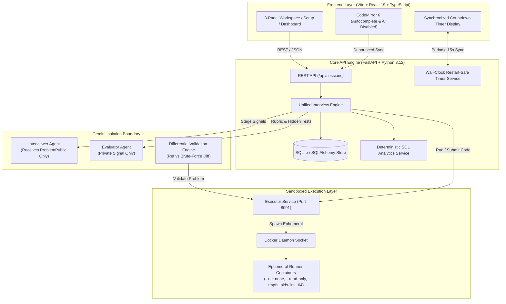
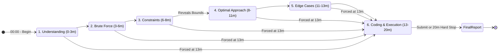
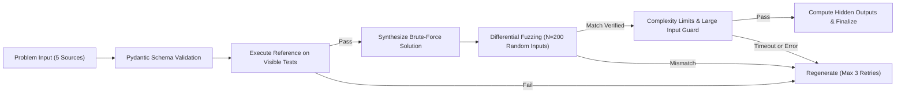

<div align="center">

# ⚡ Intervue

### *Deterministic, Local-First AI Technical Interview Simulator*

A realistic, time-boxed technical coding interview simulator engineered with zero-trust execution sandboxing, deterministic scoring, and strict AI interviewer boundaries.

[](https://python.org)
[](https://fastapi.tiangolo.com)
[](https://react.dev)
[](https://www.typescriptlang.org)
[](https://www.docker.com)
[](https://deepmind.google/technologies/gemini/)
[](#automated-test-suite)

<br/>

[Quickstart](#quickstart) •
[Architecture](#architecture) •
[Key Features](#key-features) •
[Security & Sandboxing](#security-and-sandboxing) •
[Interview Flow](#interview-flow) •
[API Reference](#api-reference) •
[Test Suite](#automated-test-suite)

</div>

---

> [!IMPORTANT]
> **Intervue is an Evaluator, Not a Tutor.**
> The AI never offers hints, pseudo-code, or debugging assistance during solving mode. All interview stage transitions, countdown timers, and verdicts are backend-authoritative and deterministic.

---

<a id="table-of-contents"></a>
## 📑 Table of Contents

- [Overview](#overview)
- [Key Features](#key-features)
- [Architecture](#architecture)
  - [System Flow & Components](#system-flow--components)
  - [6-Stage State Machine](#6-stage-interview-lifecycle)
  - [Differential Problem Validation Pipeline](#differential-problem-validation-pipeline)
- [Security & Sandboxing](#security-and-sandboxing)
- [6-Stage Interview Flow](#interview-flow)
- [Matrix of Configurations](#matrix-of-configurations)
  - [Problem Sources](#problem-sources)
  - [Practice Modes](#practice-modes)
  - [Company Styles](#company-styles)
  - [Evaluation & Scoring Dimensions](#evaluation--scoring-dimensions)
- [Quickstart](#quickstart)
  - [Prerequisites](#prerequisites)
  - [Running with Docker Compose](#running-via-docker-compose)
  - [Mock Mode (No API Key Required)](#mock-mode-offline--deterministic)
- [Local Development](#local-development)
  - [Backend Setup](#backend-setup)
  - [Frontend Setup](#frontend-setup)
  - [Executor Setup](#executor-service)
  - [Production Build & Type Checking](#production-build--type-checking)
- [Automated Test Suite](#automated-test-suite)
- [API Reference](#api-reference)
- [Environment Configuration](#environment-configuration)
- [Project Structure](#project-structure)
- [Known Limitations & Design Decisions](#known-limitations--design-decisions)
- [Phases Completed](#phases-completed)

---

<a id="overview"></a>
## 💡 Overview

Preparing for FAANG/tier-1 technical interviews requires practicing under authentic conditions: strict time limits, structured communication, adversarial probing, and unassisted implementation. 

**Intervue** simulates a genuine 20-minute engineering screen right on your machine:
- **Zero AI Help in Coding**: When you enter the coding phase, the AI interviewer completely detaches (`HTTP 409 Conflict`). Autocomplete, inline hints, and AI completions are disabled in the editor.
- **Adversarial Evaluator**: The AI interrogates your trade-offs, challenges weak complexity claims, and probes missing constraints.
- **Multi-Language Docker Sandbox**: Executes candidate solutions against hidden suites in fresh, network-isolated, ephemeral micro-containers (Python 3.12, Java 21, C++17).
- **Deterministic Analytics**: SQL-driven telemetry tracking topic strengths, verdict distributions, and your **Idea-to-Code Gap**.

---

<a id="key-features"></a>
## ✨ Key Features

| Feature | Description | Highlight |
|---|---|:---:|
| 🛡️ **Zero-Trust Isolation** | Python, Java, and C++ run inside disposable, unprivileged Docker containers (`--network none`, `--read-only`, tmpfs). | **Security** |
| 🧩 **Differential Testing** | Automatically tests Gemini's reference solution against an independent brute-force solution across 200 fuzzed inputs before presenting it. | **Reliability** |
| ⏱️ **Wall-Clock Timer** | Server-authoritative timer surviving browser crashes, network lags, and server restarts. Auto-advances and auto-terminates. | **Deterministic** |
| 🎭 **Blind Mock Mode** | Server-side redaction of problem titles, categories, and tags to eliminate problem-recognition bias. | **Authentic** |
| 📊 **Idea-to-Code Gap** | Decouples algorithmic logic scores from coding execution scores to isolate conceptual weaknesses from implementation syntax bugs. | **Analytics** |
| 🏢 **Company Styles** | Dynamic rubric weighting and tone adjustment reflecting Google, Amazon, Meta, and General interview cultures. | **Configurable** |
| 🔄 **Revision Mode** | Re-attempt previously failed problems with automatic before/after delta analysis on scores and runtime. | **Growth** |
| 🔌 **Offline Mock Mode** | Full offline functionality with zero external dependencies when no Gemini API key is provided. | **Local-First** |

---

<a id="architecture"></a>
## 🏛️ Architecture

Intervue maintains strict structural isolation between the client, deterministic server state, AI agent boundaries, and unprivileged code runners.

### System Flow & Components



### 6-Stage Interview Lifecycle

The interview progresses through 6 structured stages. Transitions are candidate-driven via the Next button, backed by strict time-box safety gates:



### Differential Problem Validation Pipeline

No generated problem is ever surfaced to the candidate without passing multi-stage differential testing in the sandbox:



---

<a id="security-and-sandboxing"></a>
## 🔒 Security & Sandboxing

Candidate code is untrusted by definition. Intervue protects the host system and the integrity of the interview through two distinct isolation layers:

### 1. Code Execution Sandboxing

All user submissions are evaluated by a dedicated internal executor running ephemeral micro-containers:

| Sandbox Control | Enforcement Parameter | Purpose |
|---|---|---|
| **Network Isolation** | `--network none` | Completely blocks outbound sockets, DNS lookups, and exfiltration attempts. |
| **Filesystem Immutability** | `--read-only` | Root filesystem cannot be modified. |
| **Volatile Storage** | `tmpfs /tmp:rw,noexec,nosuid,size=64m` | Only size-capped in-memory scratch space is writable. |
| **Privilege Revocation** | `--cap-drop ALL`, `--security-opt no-new-privileges` | Drops all Linux capabilities; prevents privilege escalation. |
| **User Demotion** | `USER sandbox` (UID 1000) | Runs as an unprivileged system user. |
| **Resource Hard-Caps** | Memory: `256MB` (no swap) • CPU: `1.0 core` | Kills memory bombs (`OOMKilled`) and CPU resource hogs. |
| **Process Bombs** | `--pids-limit 64` | Prevents fork-bombs from exhausting system threads. |
| **Execution Timeouts** | Per-test: `5s` • Total run: `15s` | Terminates infinite loops deterministically. |

### 2. Private Data & Prompt Isolation

- **AST Boundary Enforcement**: AST imports in `interviewer_service` are validated in CI to guarantee it never imports `ProblemPrivate`.
- **Zero LLM in Coding Phase**: The `/interviewer` route returns `HTTP 409 Conflict` during Stage 6.
- **Server-Side Redaction**: In `blind_mock` mode, `id`, `title`, `difficulty`, and `category` fields are sanitized to `null` before transmission.
- **Hidden Test Privacy**: Hidden test inputs/outputs are never transmitted over the wire or stored in reports; only pass/fail counts and error categories (e.g., TLE, WA) are returned.

---

<a id="interview-flow"></a>
## ⏱️ 6-Stage Interview Flow

Every interview follows a strict 20-minute timeline matching real-world technical screens:

```
[00:00] ─── Stage 1: Understanding ─────── [03:00]
            Ask clarifying questions, verify inputs & outputs
[03:00] ─── Stage 2: Brute Force ────────── [06:00]
            Formulate baseline solution, establish baseline complexity
[06:00] ─── Stage 3: Constraints ────────── [08:00]
            Server reveals bounds; deduce required optimal complexity
[08:00] ─── Stage 4: Optimal Approach ───── [11:00]
            Architect the optimal algorithm & data structures
[11:00] ─── Stage 5: Edge Cases ─────────── [13:00]
            Enumerate boundary conditions (empty, overflow, duplicates)
[13:00] ─── Stage 6: Coding & Execution ─── [20:00]  <── HARD GATEWAY
            Implement & test solution. Zero AI assistance.
```

> [!NOTE]
> Stages 1–5 have soft target windows. At **13:00 elapsed**, the backend automatically saves candidate notes and forces progression into Stage 6. At **20:00 elapsed**, the interview auto-terminates.

---

<a id="matrix-of-configurations"></a>
## 🎛️ Matrix of Configurations

<a id="problem-sources"></a>
### Problem Sources

| Source | Parameter | Mechanism | Requirements |
|---|---|---|---|
| **AI Business Scenario** | `ai_business` | Gemini wraps core DSA problems in realistic business contexts (logistics, finance, streaming). | 3+ examples, solvable ambiguity. |
| **LeetCode Paste** | `leetcode` | User pastes original problem statement & examples without scraping. | Preserves user constraints & types. |
| **Random DSA** | `random_dsa` | Curated DSA challenges across 13 foundational categories. | Avoids recent attempts via fingerprint hashing. |
| **Adaptive** | `adaptive` | Weakness-targeted problem generation based on historical dimension scores. | Cold-start requirement: 5+ completed interviews, 2+ in category. |
| **Custom Statement** | `custom` | Enter any problem statement or custom algorithmic challenge. | Must pass sandbox reference validation. |

<a id="practice-modes"></a>
### Practice Modes

| Mode | Behavior |
|---|---|
| **Standard** | Full transparency; problem metadata and category visible during setup. |
| **Blind Mock** | Problem title, category, and difficulty are stripped server-side. Simulates walking into a real interview blind. |
| **Topic Mastery** | Locks category selection (`category != mixed`) to focus drills on specific algorithmic weaknesses. |
| **Revision** | Re-attempts previously attempted problems, hiding past solutions until complete, then delivers a diff comparison report. |

<a id="company-styles"></a>
### Company Styles

| Company Style | Max Follow-ups / Stage | Tone | Rubric Emphasis |
|---|:---:|---|---|
| **Google** | 3 | Probing, terse, analytical | Optimal approach, mathematical complexity |
| **Amazon** | 2 | Structured, ownership-minded | Boundary conditions, edge cases, maintainability |
| **Meta** | 2 | Fast-paced, product-focused | Coding speed, clean syntax, execution correctness |
| **General** | 2 | Neutral, balanced | Balanced distribution across all dimensions |

<a id="evaluation--scoring-dimensions"></a>
### Evaluation & Scoring Dimensions

Scoring is composed of **10 dimensions** evaluated on a 0–10 scale:

```
┌────────────────────────────────────────────────────────────────────────┐
│                        TEN-DIMENSION SCORECARD                         │
├───────────────────────────────────┬────────────────────────────────────┤
│ 🤖 LLM Anchored Dimensions (8)    │ ⚙️ Deterministic Dimensions (2)    │
├───────────────────────────────────┼────────────────────────────────────┤
│ 1. Problem Understanding          │ 9.  Coding Ability                 │
│ 2. Communication & Clarification  │     (Computed from hidden test     │
│ 3. Brute Force Reasoning          │      pass-rate & error categories) │
│ 4. Constraint Analysis            │                                    │
│ 5. Optimal Approach Formulation   │ 10. Time Management                │
│ 6. Complexity Analysis            │     (Computed from per-stage       │
│ 7. Edge Cases Coverage            │      active time vs target windows)│
│ 8. Code Quality & Idiomatic Style │                                    │
└───────────────────────────────────┴────────────────────────────────────┘
```

#### Verdict Thresholds

Final verdicts are computed against immutable configuration constants:

- **Strong Hire**: $\ge 8.5 / 10$
- **Hire**: $\ge 7.0 / 10$
- **Borderline**: $\ge 5.5 / 10$
- **No Hire**: $< 5.5 / 10$

---

<a id="quickstart"></a>
## 🚀 Quickstart

<a id="prerequisites"></a>
### Prerequisites

- **[Docker Desktop](https://www.docker.com/products/docker-desktop/)** (running)
- **Python 3.12+**
- **Node.js 20+**

<a id="running-via-docker-compose"></a>
### Running via Docker Compose

The fastest way to spin up the entire stack (Frontend, Backend, and Executor):

```bash
# 1. Clone the repository
git clone https://github.com/m0y0nk/Intervue.git
cd Intervue

# 2. Configure environment
cp .env.example .env

# 3. Launch all services
docker compose up --build
```

#### Service URLs

| Service | Port | Endpoint |
|---|---|---|
| **Frontend Web App** | `5173` | [http://localhost:5173](http://localhost:5173) |
| **FastAPI Interactive Docs** | `8000` | [http://localhost:8000/docs](http://localhost:8000/docs) |
| **Executor Health Check** | `8001` | [http://localhost:8001/health](http://localhost:8001/health) |

<a id="mock-mode-offline--deterministic"></a>
### Mock Mode (Offline & Deterministic)

> [!TIP]
> **No Gemini API Key? No problem.**
> If `GEMINI_API_KEY` is left blank, Intervue automatically defaults to **Deterministic Mock Mode**. A verified Pair-Sum challenge is loaded, and all features (stages, countdown timer, sandbox execution, scoring, report, and dashboard) function seamlessly without external internet access.

---

<a id="local-development"></a>
## 🛠️ Local Development

If you prefer running services natively outside of full containerization:

<a id="backend-setup"></a>
<details>
<summary><b>1. Backend Setup (FastAPI)</b></summary>

```bash
cd backend

# Create and activate virtual environment
python3 -m venv ../venv
source ../venv/bin/activate   # Windows: ..\venv\Scripts\activate

# Install dependencies
pip install -r requirements.txt

# Run FastAPI server with hot-reload
uvicorn app.main:app --reload --port 8000
```
</details>

<a id="frontend-setup"></a>
<details>
<summary><b>2. Frontend Setup (Vite / React 19)</b></summary>

```bash
cd frontend

# Install npm packages
npm install

# Start Vite dev server
npm run dev
```
Access the application at `http://localhost:5173`.
</details>

<a id="executor-service"></a>
<details>
<summary><b>3. Executor Service (Docker Runner)</b></summary>

The executor requires access to the Docker socket to spawn sandboxed containers:

```bash
# Ensure Docker Desktop is active
docker compose up executor
```
</details>

<a id="production-build--type-checking"></a>
<details>
<summary><b>4. Production Build & Type Checking</b></summary>

```bash
# Frontend type check & build
cd frontend && npm run build

# Backend static analysis
cd backend && python -m mypy app/ --ignore-missing-imports
```
</details>

---

<a id="automated-test-suite"></a>
## 🧪 Automated Test Suite

Intervue includes an extensive test suite verifying sandboxing, security bounds, AST import isolation, and config engines:

```bash
# Activate virtual environment
source venv/bin/activate

# Run the complete test suite
pytest tests/ -v
```

### Test Coverage Breakdown (82 Tests)

| Test Module | Tests | Verified Behavior |
|---|:---:|---|
| `test_config_engine.py` | 12 | 422 validation rules, blind mock redactions, configuration matrices |
| `test_dashboard.py` | 17 | SQL analytics aggregation, pagination, revision selection, Gemini coaching |
| `test_evaluation_pipeline.py` | 6 | Anchored scoring, deterministic metrics, revision delta math |
| `test_executor_security.py` | 8 | Network drops, fork bombs, memory bombs, timeouts, filesystem limits |
| `test_hardening.py` | 26 | End-to-end acceptance criteria, privacy barriers, Gemini error handling |
| `test_isolation.py` | 3 | AST import boundary audit, Stage 6 zero-LLM enforcement, prompt sanitization |
| `test_language_fixtures.py` | 25 | Python, Java, C++ serialization, harness type parity, container security |
| `test_session_flow.py` | 1 | Full interview lifecycle (create → begin → stages → submit → score report) |
| `test_sources.py` | 5 | All 5 problem sources, adaptive cold-start verification |
| `test_styles_config.py` | 1 | Company style parameter validation and rubric weighting |
| `test_timer.py` | 4 | Precision calculation, pause/resume drift, auto-stage, auto-terminate |

> [!NOTE]
> Tests executing real container workloads (`test_executor_security.py` and `test_language_fixtures.py`) require Docker Desktop to be running.

---

<a id="api-reference"></a>
## 📡 API Reference

Intervue exposes a clean, RESTful API documented via OpenAPI / Swagger at `http://localhost:8000/docs`:

<details open>
<summary><b>Key REST Endpoints</b></summary>

| Method | Endpoint | Description |
|---|---|---|
| `POST` | `/api/sessions` | Create session (202 Accepted, async problem synthesis) |
| `GET` | `/api/sessions/{id}` | Retrieve session state, remaining wall-clock time, public problem |
| `POST` | `/api/sessions/{id}/begin` | Start the authoritative 20-minute timer |
| `POST` | `/api/sessions/{id}/pause` | Pause active countdown |
| `POST` | `/api/sessions/{id}/resume` | Resume countdown |
| `POST` | `/api/sessions/{id}/reset` | Abandon current session and mark abandoned |
| `POST` | `/api/sessions/{id}/stage/next` | Advance to the subsequent interview stage |
| `PUT` | `/api/sessions/{id}/notes` | Save candidate scratchpad notes for active stage |
| `PUT` | `/api/sessions/{id}/code` | Autosave candidate source code |
| `POST` | `/api/sessions/{id}/interviewer` | Chat with AI interviewer (*Stages 1–5 only; 409 in Stage 6*) |
| `POST` | `/api/sessions/{id}/run` | Execute against visible test cases (*Rate-limited: 1 req / 5s*) |
| `POST` | `/api/sessions/{id}/submit` | Execute against hidden test suite & generate evaluation report |
| `GET` | `/api/sessions/{id}/report` | Retrieve final evaluation report and scorecard |
| `GET` | `/api/dashboard` | Fetch deterministic SQL metrics & history |
| `GET` | `/api/dashboard/recommendations` | Generate Gemini coaching guidance from computed metrics |
| `GET` | `/api/history` | Paginated session history |
| `GET` | `/api/revision/candidates` | List past problem sessions eligible for revision mode |
| `GET` | `/health` | Backend and database connectivity status check |

</details>

---

<a id="environment-configuration"></a>
## ⚙️ Environment Configuration

Configuration is managed via `.env` in the project root:

```env
# Google Gemini API Key (leave empty for Deterministic Mock Mode)
GEMINI_API_KEY=

# Gemini model identifier
GEMINI_MODEL=gemini-2.0-flash-exp

# Database connection URL (SQLite Docker volume by default)
DATABASE_URL=sqlite:///./intervue.db

# Executor microservice URL
EXECUTOR_URL=http://localhost:8001

# Allowed CORS origins
CORS_ORIGINS=http://localhost:5173,http://localhost:3000
```

---

<a id="project-structure"></a>
## 📂 Project Structure

```
dsa-practice/
├── backend/
│   ├── app/
│   │   ├── api/             # FastAPI REST route definitions (sessions, dashboard)
│   │   ├── config/          # Style matrices and application constants
│   │   ├── database/        # SQLite database connection & session setup
│   │   ├── execution/       # Language harnesses (Python, Java, C++) & Dockerfiles
│   │   ├── models/          # SQLAlchemy database models
│   │   ├── prompts/         # Structured Gemini prompt templates
│   │   ├── schemas/         # Pydantic schemas (ProblemPublic, ProblemPrivate, Report)
│   │   ├── services/        # Business logic (engine, timer, evaluator, validator)
│   │   └── main.py          # Application entrypoint & CORS middleware
│   ├── Dockerfile
│   └── requirements.txt
├── executor/
│   ├── harness/             # Base execution harnesses
│   ├── Dockerfile           # Ephemeral container manager image
│   ├── main.py              # Docker socket controller & sandbox isolation API
│   └── requirements.txt
├── frontend/
│   ├── src/
│   │   ├── components/      # CodeEditor, Timer, ProblemPanel, InterviewerPanel
│   │   ├── pages/           # SetupPage, WorkspacePage, DashboardPage
│   │   ├── services/        # Frontend API client
│   │   └── types/           # TypeScript interfaces & state schemas
│   ├── Dockerfile
│   └── package.json
├── tests/                   # 82 automated unit, integration, and security tests
├── docker-compose.yml       # 3-tier local service orchestration
├── .env.example             # Template environment variables
└── README.md
```

---

<a id="known-limitations--design-decisions"></a>
## ⚠️ Known Limitations & Design Decisions

<details>
<summary><b>Click to expand engineering trade-offs</b></summary>

1. **SQLite Single-Writer**: Intervue uses SQLite for zero-friction local setups. For concurrent multi-user environments, swap `DATABASE_URL` to PostgreSQL (SQLAlchemy models are fully compatible).
2. **Gemini Developer API Structured Output**: `response_schema` with `additionalProperties` constraints is an Enterprise Agent feature. When unavailable, Intervue falls back to verified deterministic mocks or structured parsing.
3. **Privileged Docker Socket**: The executor interacts with `/var/run/docker.sock` to launch sandboxed containers. Suitable for local single-user developer machines; in shared hosting, utilize rootless Docker or gVisor.
4. **LeetCode Problem Ingestion**: Due to the absence of an official LeetCode public API and the unreliability of scraping, users paste the problem statement and examples directly.
5. **Adaptive Cold-Start Gate**: Adaptive mode enforces a minimum of 5 finished sessions and 2 sessions per category to prevent synthetic or inaccurate weakness scoring.
6. **Context Limit Window**: To ensure evaluation prompts remain within token boundaries, only the last 12 interviewer chat messages are evaluated in the final scorecard.
7. **Session Immutability**: Language choice is locked at session creation to guarantee consistent container harness execution throughout the 6 stages.

</details>

---

<a id="phases-completed"></a>
## 🗺️ Phases Completed

| Phase | Milestone | Status |
|:---:|---|:---:|
| **01** | Thin vertical slice: Python execution sandbox, 6-stage flow, timer, basic report | ✅ Complete |
| **02** | Multi-language harnesses: Java 21 & C++17 runner images and type marshaling | ✅ Complete |
| **03** | Configuration engine: All modes, styles, validation rules, blind-mode redaction | ✅ Complete |
| **04** | 5 Problem sources: `ai_business`, `adaptive`, `leetcode` paste, `custom`, `random_dsa` | ✅ Complete |
| **05** | Evaluation pipeline: Anchored scoring, Idea-to-Code Gap, revision comparison | ✅ Complete |
| **06** | Dashboard & SQL analytics: Deterministic metrics, category trends, Gemini coach | ✅ Complete |
| **07** | Hardening & Verification: 82 acceptance tests, failure handling, documentation | ✅ Complete |

---

<div align="center">

Made for engineers who want real interview preparation.

</div>
